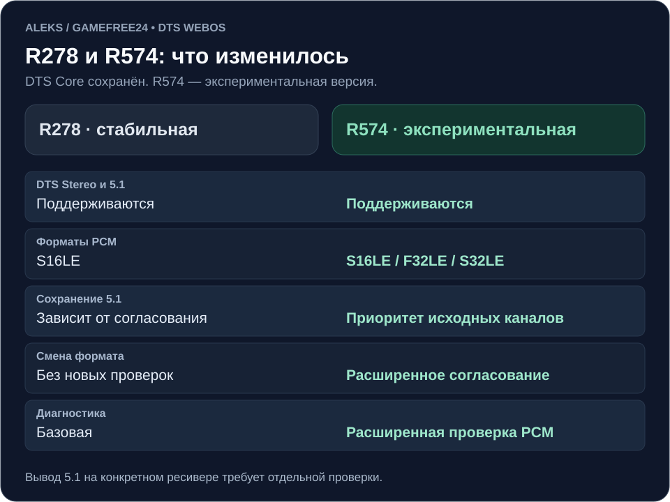

# AlekS DTS R574 — экспериментальная ветка

> **Предварительная документация. Установочного пакета R574 пока нет.** Не используйте унаследованный установщик R278 для установки R574.

[Описание изменений, сравнение и план испытаний R574](R574-PREVIEW.md)



Для стабильной версии и актуальной инструкции установки используйте [основную ветку main](https://github.com/aerolit266/AlekS-DTS-webOS/tree/main).

## Проверка с публичной R278

[Отчёт о лабораторной совместимости R574](R574-PUBLIC-BASELINE-QA.md): 8/8 PASS, исходный PCM S16LE побайтно сохранён, AC3 без изменений, лабораторное восстановление 4/4 файлов. Это не проверка системного отката на телевизоре.

## Предварительная диагностика совместимости R574

[Утилита check-r574-compat.sh](check-r574-compat.sh) — только сбор сведений на собственном LG, без установки, изменения настроек, перезапуска служб и записи звука. Можно выполнить до появления публичного пакета, в том числе на телевизоре с уже установленной R278.

В существующем SSH-сеансе своего телевизора:

```sh
cd /tmp
curl -fLsS 'https://raw.githubusercontent.com/aerolit266/AlekS-DTS-webOS/9d9e32110d7cdfc915cbea5970feec295d37673b/check-r574-compat.sh' -o check-r574-compat.sh
printf '%s  %s\n' 'b8e526d5269a498b47a7f85c914dc74a0c6863ddc14ace19ebf488fc615fac75' check-r574-compat.sh | sha256sum -c - && sh check-r574-compat.sh
```

В отчёте: ABI трёх медиакомпонентов, версия GStreamer, состояние служб, наличие записи R278, совпадение конфигурации по известному пути (другой путь может дать UNKNOWN), свободное место. Нет содержимого конфигураций, адресов или учётных данных. Приложите модель, версию прошивки и webOS вручную.

`ABI_MATCH=yes` означает совпадение проверенного ELF ABI, а не разрешение установки. `GST_LAB_BASELINE=MATCH` означает совпадение с лабораторной версией 1.16.2, но не доказательство полной совместимости. Утилита всегда завершает штатный отчёт строкой `INSTALL_ALLOWED=NO`. Она не проверяет звук.

QA утилиты: синтаксис POSIX sh и BusyBox sh — PASS; классификация ELF на синтетических заголовках — 9/9 в каждой оболочке (18/18). Полное выполнение на обычном Linux — безопасный отчёт без разрешения установки. На LG 65NANO896PC (webOS 6, GStreamer 1.16.2) опубликованная утилита успешно выполнена после проверки SHA256. ABI всех трёх медиакомпонентов совпал с ARM32 EABI5 soft-float, обе службы активны. Результат INVENTORY_ONLY; разрешение на установку не выдаётся.

**Пакет R574 и обновление поверх R278 пока не опубликованы:** необходимо завершить проверку совместимости, отката и условий распространения новой обёртки. Стабильная R278 доступна в main.

## Лицензирование

[**AlekS Binary License 1.0 (ABL-1.0)**](LICENSE-ALEKS-BINARY.md) — собственные условия для явно обозначенных авторских бинарных компонентов будущих выпусков. Лицензия не распространяется автоматически на R278, сторонние библиотеки, документацию или ранее лицензированные копии. Для каждого релиза требуется отдельный перечень компонентов и применимых лицензий.

R574 пока не имеет публичного бинарного релиза. Публикация текста ABL-1.0 сама по себе не подтверждает возможность перелицензирования всех компонентов.

© 2026 AlekS / GameFree24.
